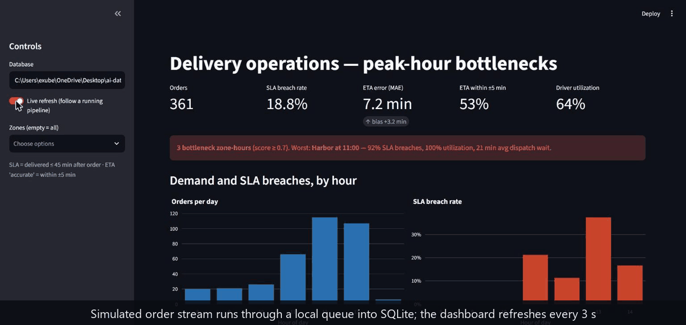
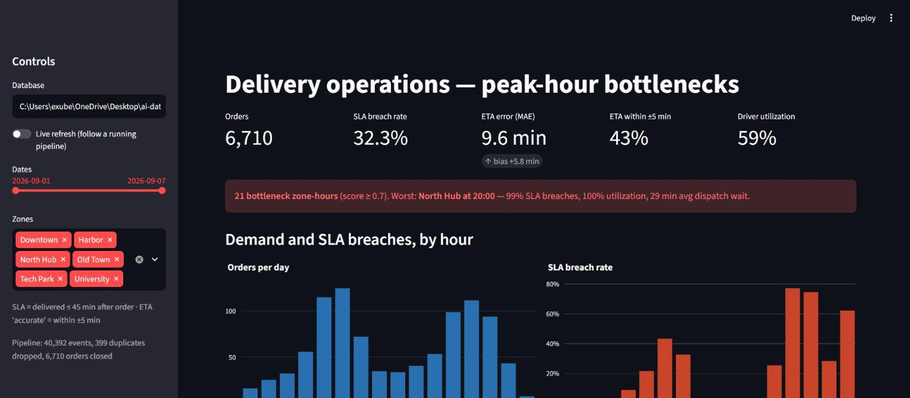
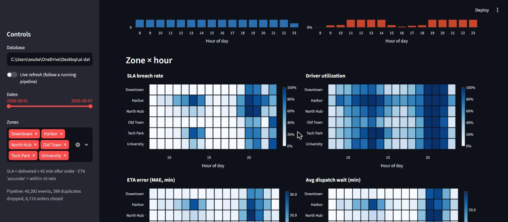
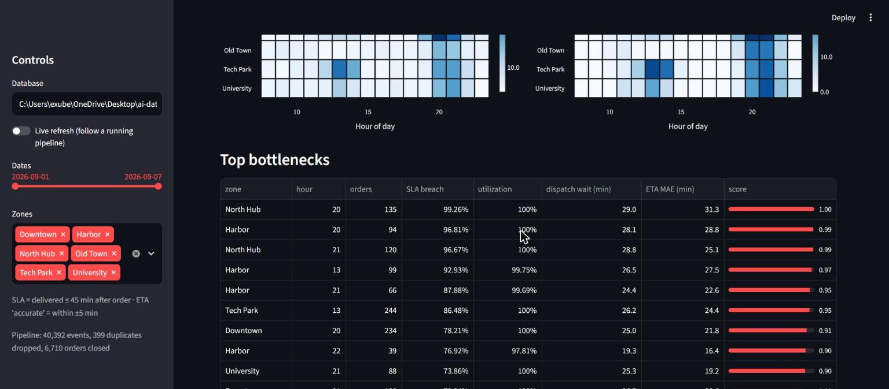
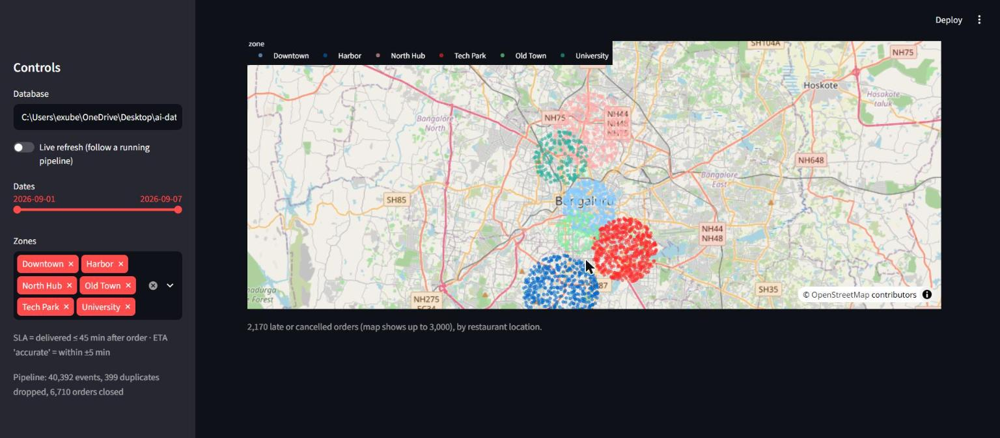

# Real-Time Delivery Ops Pipeline

Simulated order-event stream → queue-based pipeline → zone/hour KPIs → bottleneck dashboard.

```
simulator (generator) ──▶ bounded queue.Queue ──▶ consumer ──▶ SQLite ──▶ Streamlit dashboard
 orders, drivers, geo       producer thread       dedupe, order-state     events, fact_orders,
 dup + out-of-order events                        assembly, metrics       driver_shifts, metrics_zone_hour
```



## Quick start

Requires Python 3.11+.

```powershell
py -3.13 -m venv .venv
.\.venv\Scripts\pip install -e ".[dev]"
.\.venv\Scripts\delivery-ops run --days 7        # simulate + run the pipeline (~7 s)
.\.venv\Scripts\streamlit run dashboard/app.py   # open the dashboard
.\.venv\Scripts\python -m pytest                 # tests
```

macOS/Linux: same commands with `python -m venv .venv`, `source .venv/bin/activate` and no `.exe`/backslashes.

Live mode: run `delivery-ops run --throttle 0.002` and turn on **Live refresh** in the dashboard sidebar.

## Results (7 simulated days, seed 42)



40,392 events (399 duplicates dropped) became 6,710 orders. Headline numbers:

| | |
|---|---|
| SLA breach rate | 32.3% |
| ETA error (MAE) | 9.6 min (quoted ETAs run 5.8 min optimistic on average) |
| ETA within ±5 min | 43% |
| Driver utilization | 59% overall, 100% in peak hours |

What the data shows:
- **Dinner is the worst window.** North Hub at 20:00 breaches the SLA on 99% of orders with 100% utilization and a 29 min average wait for a driver. Zone-hours at 20:00-21:00 dominate the top of the bottleneck table.
- **Lunch hurts in Tech Park and Harbor** (13:00, 86-93% breach). Tech Park has the strongest lunch demand; Harbor has the fewest drivers.
- **ETA error tracks load.** MAE is about 5 min off-peak and 20-30 min in the worst zone-hours, because the quoted ETA ignores driver queueing and traffic.
- Capacity is the cause, not demand alone: the staggered shifts leave only a third of drivers online after 20:00.





> The data is **simulated**; the numbers come from the assumptions in `config.py`, not from a real fleet.

## Event stream
`ORDER_PLACED → DRIVER_ASSIGNED → PICKED_UP → IN_TRANSIT (GPS ping every 4 min) → DELIVERED`, plus
`ORDER_CANCELLED` (customer gives up while waiting for a driver) and `DRIVER_ONLINE/OFFLINE`.
The stream has ~1% duplicate events and up to 45 s of arrival jitter; the consumer de-duplicates by
`event_id` and assembles orders regardless of arrival order.

## Simulation model (src/delivery_ops/config.py)
- 6 zones with geo-scattered restaurants/customers; Poisson demand with lunch (12–14) and dinner (19–21) peaks.
- Finite drivers per zone on staggered 8 h shifts (08–16, 12–20, 16–24), so supply is thin after 20:00.
- FIFO dispatch to the first-available driver; traffic slows drivers at peak.
- **Quoted ETA is deliberately naive** (prep + distance, no load/traffic) so its error grows at peaks.

## Metrics (src/delivery_ops/metrics.py), per date × zone × hour
| Metric | Definition |
|---|---|
| SLA breach rate | (delivered > 45 min after placement + cancelled) ÷ orders placed in that hour |
| ETA accuracy | MAE and bias of (actual − quoted) minutes; share within ±5 min |
| Driver utilization | driver-busy seconds (assigned → delivered) ÷ on-shift seconds in that hour |
| Bottleneck score | 0.4·utilization + 0.4·breach rate + 0.2·(dispatch wait ÷ 15 min) |

Metrics are stored as additive components, so any date/zone slice re-aggregates exactly.
